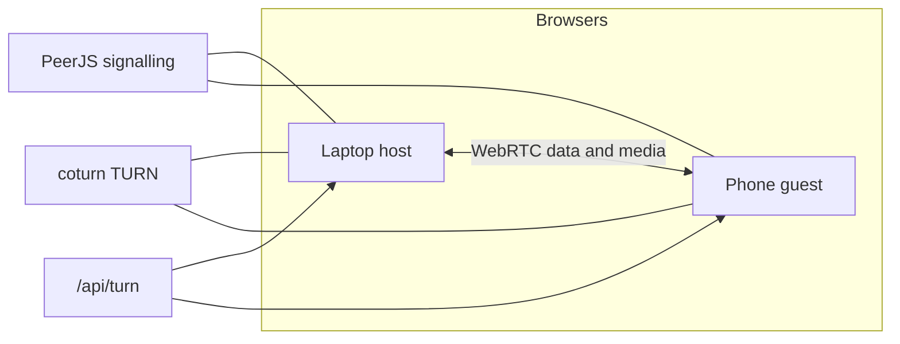

# Architecture

PhonePair is a Vite + React 18 + TypeScript app. The browser bundle is static. One function, `api/turn.js`, mints TURN credentials for the peer connection.

## App shell and routing

`src/main.tsx` mounts `src/App.tsx`. The shell owns routing, the `Link` lifecycle, bus wiring, and toasts.

| URL | Who |
| --- | --- |
| `/` on a desktop browser | **Host** (laptop). |
| `/` on a phone user agent | Code entry. That screen can switch this device to the laptop side. |
| `/?as=host` | Host, including on a phone. |
| `/j/ABC123` | **Guest** (phone) joining that code. The QR code points here. |
| `/?c=ABC123` | Guest, same join as `/j/ABC123`. |

The host stores its code in `sessionStorage` under `pp-code`. A laptop reload keeps the code, so the phone can reconnect to the same peer.

`Laptop.tsx` shows the QR landing, then the paired dashboard (feature panels and overlays). `Phone.tsx` shows code entry, the connecting state, home tiles, and a feature page.

## Connection (`src/core/link.ts`)

`Link` wraps the PeerJS connection: pairing, heartbeat, and reconnect.

- The host peer id is `phonepair-` plus the code in lowercase. The guest dials that id on a reliable data channel with binary serialization.
- On open, each side sends `hello` with a device name. `bye` ends the session. `ping` is the heartbeat. Those three types are reserved by the core.
- A ping is sent every 4 seconds. If nothing has arrived for 15 seconds, the link is treated as lost. The phone redials. The laptop returns to waiting and keeps the same code.
- A dropped signalling socket is reconnected. A closed data channel makes the guest dial again. If the host id is still taken by an old session, the laptop retries, then rolls a new code.
- ICE servers come from `GET /api/turn`. `?relay=1` sets `iceTransportPolicy` to `'relay'` (TURN only). The default policy is `'all'`.

## Message bus (`src/core/bus.ts`)

Features talk to the other device through the bus.

- `ctx.send({ t: 'area:thing', ... })` delivers a message to the other device. Prefix the type with the feature area (`text:`, `file:`, `clip:`, and the same shape for any other area). Payloads may include `Uint8Array` or `ArrayBuffer`.
- `onMessage(type, handler)` subscribes for the life of the link. Register it from `init`, so it runs while that feature's page is closed. `onMessage('*', ...)` sees every dispatched message. `useMessage` is the same subscription, tied to a component.
- `createStore(initial)` returns `{ get, set, use, subscribe }`. The value lives at module scope, so it survives phone page changes.
- `ctx.role` is `'host'` or `'guest'`. `ctx.toast`, `ctx.openPage(featureId)` (phone), and `ctx.link` (status, remote name, code, the data connection, `disconnect`) are on the same object.
- Media is one-way. The sender calls `ctx.call(stream, kind)`. The receiver registers `onCall(kind, handler)` from `init`, answers the call, and listens for the stream. One handler per kind. A call with no handler is closed.

`dispatch` routes incoming data messages. `dispatchCall` routes incoming media by `metadata.kind`. `App.tsx` wires both when the link is created, and runs each feature's `init` once.

## How a feature plugs in

Add `src/features/<area>/index.tsx`. The module calls `registerFeature` as it loads. Then add one import line to `src/features/index.ts`:

```ts
import './files'
import './text'
import './clipboard'
```

`App.tsx` imports that file, so no other core edit is required.

```tsx
import { registerFeature, onMessage, createStore } from '../../core/bus'

const state = createStore<string[]>([])

registerFeature({
  id: 'text',
  title: 'Text / link',
  icon: 'link',
  order: 20,
  laptopColumn: 'left',
  PhonePage: ({ ctx }) => null,
  LaptopPanel: ({ ctx }) => null,
  init: (ctx) => onMessage('text:msg', (m, ctx) => { /* receiving device */ }),
})
```

`getFeatures()` sorts by `order`. The phone home screen renders a tile per feature that has `PhonePage`. The laptop dashboard renders `LaptopPanel` in the left or right column, and `LaptopOverlay` as a full-screen layer. The modules wired in `src/features/index.ts` are files (order 10), text (20), and clipboard (30). Suggested orders for further areas, using this same hook: remote 40, camera 50, mic 55, scan 60, screen 70.

## `/api/turn`

`GET /api/turn` responds with JSON `{ iceServers, ttl }` and `Cache-Control: no-store`.

It reads `TURN_SECRET` and builds coturn REST credentials:

- With the variable unset, the body is STUN servers only and `ttl` is `0`.
- With the variable set, TTL is 6 hours. The username is `<unix expiry>:phonepair`. The credential is base64(HMAC-SHA1(username)), keyed by `TURN_SECRET`. The TURN URL is included for UDP and for TCP, both on port 3478.

The browser requests this once as the link starts and passes `iceServers` into PeerJS.


