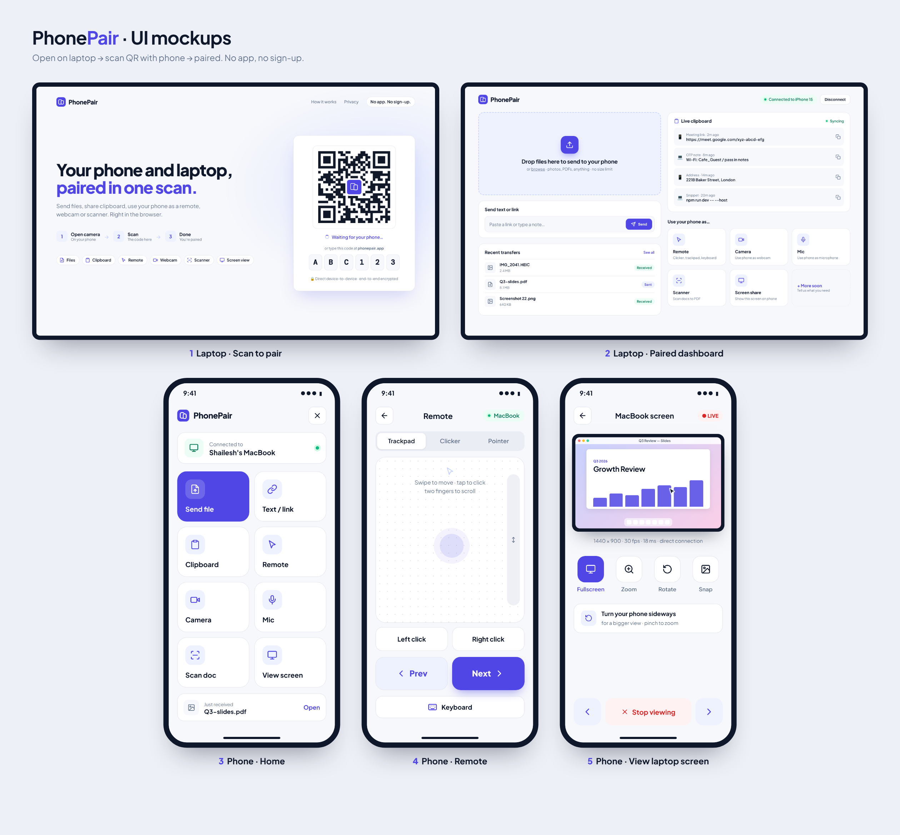

# PhonePair


<!-- This hero image will be replaced with a real screenshot after deploy. -->

Pair your phone with your laptop in the browser. Scan a QR code, or type a 6-character code, and move things between the two devices. No app install.

Live: [phonepair.vercel.app](https://phonepair.vercel.app)

## Features

1. **Pairing by QR and a 6-character code, with auto-reconnect.** The laptop shows a QR code and the code next to it. The phone scans the QR (it opens `/j/` plus the code) or types the code. Codes are six characters drawn from an alphabet that leaves out `I`, `O`, `0`, and `1`. The laptop keeps its code in `sessionStorage`, so a reload uses the same code and the phone reconnects on its own. A ping goes out every 4 seconds. After 15 seconds of silence the phone redials, and the laptop goes back to waiting on that same code. If the old code is still held after 5 retries (about 12s), the laptop gets a new code and the phone needs to pair again.

2. **Text and links, both ways.** Either device can send a note or a URL. Links in the text stay clickable, and both sides keep the thread.

3. **Files and screenshots, both ways.** Drop files, pick them, or paste a screenshot. Transfers go in 64 KB chunks with a progress bar, in either direction. A pasted screenshot is named with the time it was sent. A received file can be saved on the other device.

4. **Live clipboard.** A shared text box. Typing or pasting on one device shows up on the other, with a short history of recent clips.

5. **Phone as a remote.** The phone is a trackpad for the laptop, with Prev and Next controls and a keyboard.

6. **Phone as a camera, microphone, and scanner.** The laptop can use the phone's camera, mic, or a document scan. Picture and sound travel as a one-way WebRTC media call.

7. **Laptop screen on the phone.** View the laptop screen from the phone.

## How it works

Both sides run in the browser. After pairing they talk over WebRTC: data channels carry messages, files, and clipboard text, and media calls carry camera, mic, and screen. [PeerJS](https://peerjs.com/) opens those connections.

A PeerJS signalling server introduces the two browsers so they can negotiate the session. The laptop's peer id is `phonepair-` plus the pairing code in lowercase.

When a direct path is blocked, a coturn TURN relay carries the traffic. The page asks `GET /api/turn` for ICE servers, and that function mints short-lived TURN credentials. Add `?relay=1` to the URL to force TURN-only (`iceTransportPolicy` set to `'relay'`) when you want to test the relay.

## Known limits

- On networks that only allow TCP 443, the relay won't connect, because TURN runs on port 3478 (UDP/TCP) only; TURN over TLS on 443 is planned.
- `/api/turn` issues 6-hour TURN credentials to any caller; rate limiting is planned.

## Local development

```bash
npm ci
npm run dev
```

`npm run build` typechecks the project and writes the static site to `dist`.

## Environment variables

| Name | Role |
| --- | --- |
| `TURN_SECRET` | Shared secret read by `/api/turn`. When it is set, `/api/turn` returns TURN credentials. When it is unset, `/api/turn` returns STUN only. |

## Deploy

PhonePair deploys on Vercel. Production deploys come from `main` only, on the free plan. The framework preset is Vite and the output directory is `dist`. The deployment also includes the `api/turn.js` function.

## License

[MIT](LICENSE)
